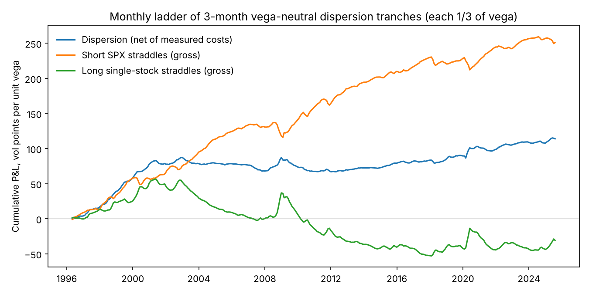
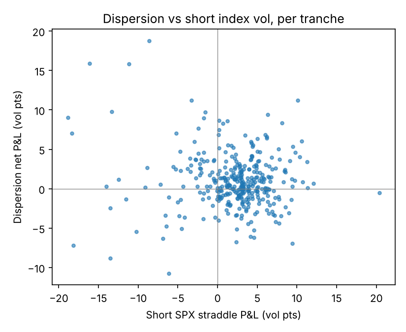

# The plain dispersion trade on the S&P 500, 1996–2025

*Descriptive analysis, separate from the pre-registered test. Code: `src/simple_dispersion.py`, `src/simple_dispersion_report.py`. Full output: `simple_dispersion_report.txt`.*

## The trade

On the first trading day of every month, open a 3-month tranche:

- **Short** an ATM-forward straddle on SPX.
- **Long** ATM-forward straddles on the 50 largest S&P 500 members (market cap at the previous month end), vega split by index weight.
- **Vega-neutral:** the same vega on the two legs.
- Each straddle is **delta-hedged daily** at its inception implied vol and **held to expiry** (63 trading days). Three tranches are live at any time.

**How P&L is measured.** Entry prices come from market implied vols (OptionMetrics 91-day ATM-forward). The hedge and the payoff are computed on the **actual price paths** (CRSP prices, splits, dividends; SPX), with financing at the OptionMetrics zero curve. P&L is in **vol points per unit of vega**. For example, with $100k vega per leg, 1 vol point is $100k per tranche.

**Costs.** Half bid/ask paid at entry, **measured on listed options**: on each entry date, for SPX and for every top-50 name, `src/select_contracts.py` picks the standard monthly listed straddle closest to 91 days and to the spot strike (both legs quoted, tightest spread). Half-spread in vol points = (call spread + put spread) / 2 ÷ straddle vega. The basket cost is index-weighted; names with no listed quote on that date take the basket median.

| Period | Single-stock basket | SPX | Weight share with a listed quote |
|---|---|---|---|
| 1996–2000 | 1.15 | 0.42 | 68% |
| 2001–2007 | 0.70 | 0.48 | 70% |
| 2008–2009 | 0.64 | 0.65 | 70% |
| 2010–2019 | 0.26 | 0.31 | 89% |
| 2020–2025 | 0.37 | 0.06 | 98% |

Average round-trip-equivalent entry cost is 0.91 vol points per tranche, against 0.65 in our earlier desk assumption (0.50 single + 0.15 index). Pre-2001 single-stock spreads were wide (fractional tick sizes). SPX quotes in OptionMetrics were wide until about 2012 and have been very tight since. Before 2010 about 30% of the basket weight has no standard listed expiry near 3 months (quarterly expiry cycles), so its cost is imputed.

## Results

Net of measured costs:

| Period | Tranches | Mean, net (vol pts) | t-stat (NW) | Sharpe (ann.) | Hit rate | Worst | Best |
|---|---|---|---|---|---|---|---|
| 1996–2007 | 143 | 1.44 | 3.23 | 0.82 | 64% | −6.2 | 11.2 |
| 2008–2009 | 24 | 0.59 | 0.40 | 0.19 | 54% | −10.7 | 15.9 |
| 2010–2019 | 120 | 0.33 | 1.24 | 0.31 | 61% | −8.8 | 7.5 |
| 2020–2025 | 65 | 1.27 | 1.90 | 0.68 | 57% | −4.2 | 18.8 |
| **Full sample** | **352** | **0.97** | **3.79** | **0.56** | **61%** | −10.7 | 18.8 |

Gross of costs, the full-sample mean is 1.88 vol points per tranche and the Sharpe ratio is 1.05. With the flat desk costs it was 1.23 (Sharpe 0.69). Using all ~500 members instead of the top 50 changes little (net mean 0.92, Sharpe 0.57).

**Where the money comes from**

- **The index leg.** Short SPX straddles earn +2.1 vol points per tranche: the index variance risk premium.
- **The single-stock leg.** Long single-stock straddles lose −0.3 vol points on average, roughly break-even: single-stock implied vol is close to fair.
- **The edge is concentrated.** 1996–2007 and the 2020s carry the result. In 2010–2019 the net mean is 0.33 vol points and not significant (t 1.2).

**Costs matter.** Break-even is at about twice the measured spreads:

| Cost multiple (1× = measured half-spreads) | 0× | 0.5× | 1× | 1.5× | 2× | 3× |
|---|---|---|---|---|---|---|
| Mean (vol pts) | 1.88 | 1.42 | 0.97 | 0.52 | 0.07 | −0.84 |
| Sharpe | 1.05 | 0.81 | 0.56 | 0.30 | 0.04 | −0.47 |

## Is it just a factor bet?

The dependent variable is P&L per tranche net of measured costs. Factors are summed over each tranche's life. Standard errors are Newey-West with 2 lags.

| Model | Alpha (vol pts/tranche) | t(alpha) | R² |
|---|---|---|---|
| CAPM | 1.35 | 5.05 | 0.13 |
| Fama-French 5 + momentum | 1.36 | 4.82 | 0.20 |
| FF5 + momentum + ΔVIX | 1.30 | 4.82 | 0.20 |
| Short SPX vol only | 1.13 | 3.22 | 0.01 |
| All of the above | 1.06 | 3.20 | 0.22 |

- **Alpha survives every specification.** Standard equity factors explain less than a fifth of the variance.
- **Negative market beta.** Dispersion P&L is higher when the market falls. A vega-neutral book is net long the *level* of volatility, because single-stock vols move more in points than index vol. This bias offsets the correlation spike in sell-offs, which is why 2008 and 2020 were profitable tranches rather than losses.
- **It is not short index vol in disguise.** The tranche P&L is essentially uncorrelated with the short-SPX-straddle P&L (R² 0.01).

## Index skew: straddles vs variance swaps

The model-free 3-month SPX variance-swap strike, computed from the OptionMetrics smile in the same way as the VIX, averages 20.3 against 18.6 for ATM vol. That is 1.8 vol points of skew premium.

- A short SPX variance swap struck at the true model-free strike earns +1.7 vol points per tranche.
- Struck at ATM vol, it would earn about zero.

So a variance-swap version of the dispersion trade needs proper model-free strikes on both legs, which requires the single-stock smiles. The straddle version above is not affected, because straddles are priced at ATM vol.

## Caveats

- Entry uses OptionMetrics interpolated ATM-forward vols; only the spread comes from listed quotes. The listed-contract engine of the pre-registered test (part 3) trades the actual listed contracts.
- Single-stock options are American; early exercise is ignored.
- The hedge is at the close, without hedging costs.
- Exact delta-hedged P&L differs materially from the common shortcut "vega × (realized − implied vol)": the correlation between the two is 0.64.
